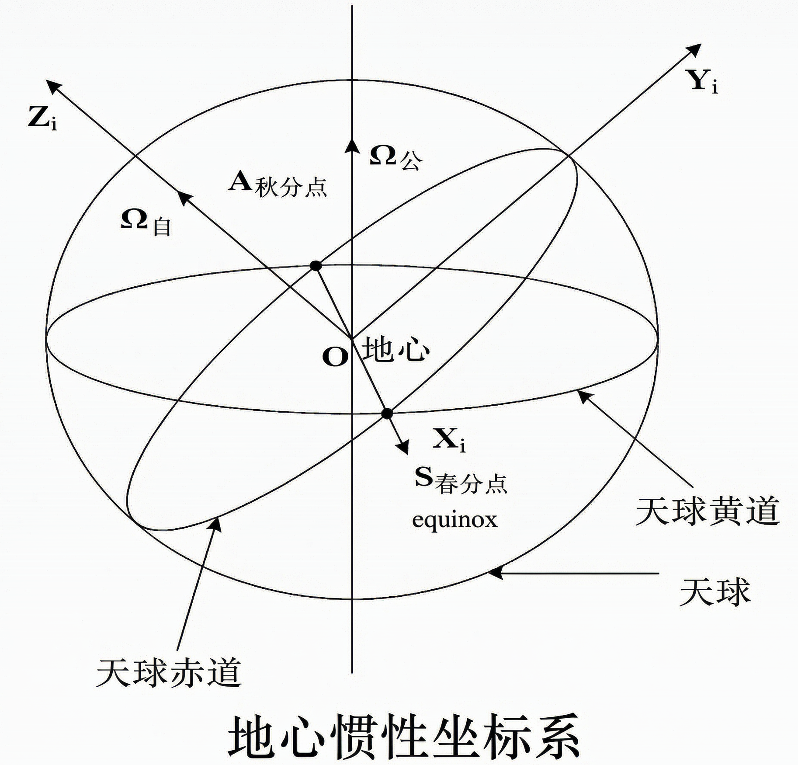
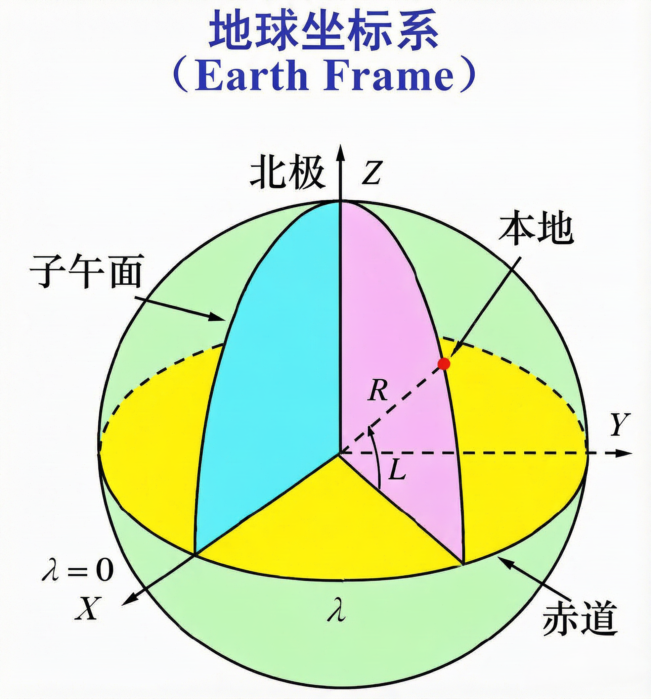
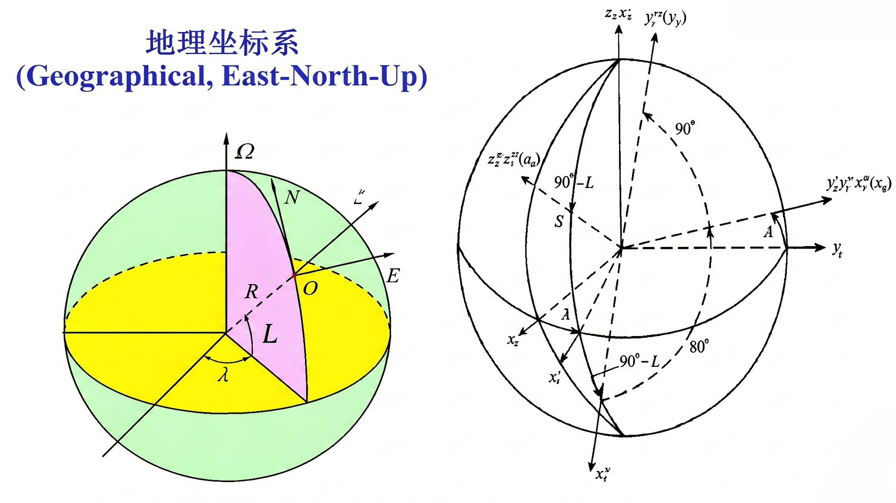
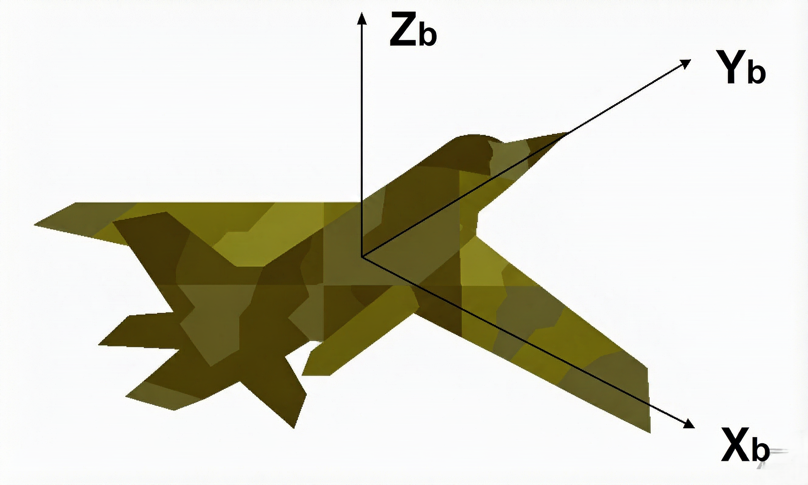

## 学情分析

**课程学习意义有限，计算要求少，理解为主，无须深究**

**考试计算涉及较少，原理覆盖课件全部，都要理解**

惯导系统解算方法、误差分析方法、初始对准技术、惯性器件测试技术、惯导系统标定技术、组合导航技术等

重点分析误差对自主导航系统的影响、解决措施和提高导航精度的方法和途径 

通过课堂教学和实验教学，使学生能独立完成捷联惯导系统标定、对准和导航解算全过程

## 导航定义

定义一：导航是指在某参考系内将运动物体（载体）从起始点引导到目的地的技术或方法

定义二：通过几何学、天文学、无线电信号等任何手段确定或规划船舶、飞机的位置及航线的方法

## 导航科学与导航方法

- 导航科学：确定运动物体相对已知参考系统 的位置、速度和姿态;

- 导航方法：由一个地方 到另一个地方航线的规划与保持,回避障碍并避免碰撞。 也可称为制导、领航或航线规划

## 导航系统

狭义：提供位置、速度

广义：提供位置、速度、姿态

注：定位只确定载体的空间位置（不包括速度和姿态），许多导航技术严格来讲是定位技术（根据位置变化率推到速度）

## 常用导航方法

- 惯性导航：陀螺仪和加速度计 积分解算
- 天文导航：天体的高度角和方位角，利用六分仪或星敏感器确定位置

- 航标导航
- 地标导航
- 视觉导航

- 仿生导航

- 重力、地磁导航：重力场和磁场在不同经纬度有细微差异

- 无线电导航：无线电波从发射塔（或卫星）传到接收机的时间差解算

## 导航的分类

- 观测法：航标、天文、无线电等

- 推算法：惯性导航

自主导航定义：不依赖地面支持,载体完全依靠自身携带的测量设备，实时地完成导航任务，和外界不发生任何光、电联系

- 自主导航：惯性导航、天文导航、卫星导航（准自主导航）

- 非自主导航：...

注：自主导航≠推算法，关键在于是否依赖“人工辐射源”

## 惯性导航系统

**组成**：加速度计（加速度）、陀螺仪（角速度）、导航计算机

**平台式惯导系统**（昂贵，高精尖）：万向架结构，陀螺仪为加速度计提供指向稳定的基座（机械式、光学、MEMS微电机）

$\star$ **捷联式惯导系统**（便宜，简单）：固定结构，实时计算出一个“数学平台”

## 惯导系统的优缺点

优点：隐蔽性、抗干扰、全时段、连续性、更新率高、稳定性

缺点：累积误差、对准时间长、价格高、不能给出时间信息

## 欧拉角核心原理

### 1. 欧拉角旋转的本质

欧拉角用 **3 次有顺序的单轴旋转** 描述三维姿态。旋转顺序是定义的一部分；即使三个角数值相同，顺序不同，最终姿态通常也不同，因为三维旋转一般不满足交换律：

$$
R_aR_b \ne R_bR_a.
$$

---

### 2. ZYX 旋转顺序及矩阵

三个基本旋转矩阵为：

$$
C_{i}^{j}(z_i,\theta)=
\begin{bmatrix}
\cos\theta & \sin\theta & 0\\
-\sin\theta & \cos\theta & 0\\
0 & 0 & 1
\end{bmatrix}
$$

$$
C_i^j(y_i,\theta)=
\begin{bmatrix}
\cos\theta & 0 & -\sin\theta\\
0 & 1 & 0\\
\sin\theta & 0 & \cos\theta
\end{bmatrix}
$$

$$
C_i^j(x_i,\theta)=
\begin{bmatrix}
1 & 0 & 0\\
0 & \cos\theta & \sin\theta\\
0 & -\sin\theta & \cos\theta
\end{bmatrix}
$$

ZYX 姿态矩阵为：

$$
R=R_z(\psi)R_y(\theta)R_x(\phi).
$$

- 内禀 ZYX 顺序，从左到右作用与基
- 矩阵乘法从右向左作用于向量

---

### 3. 角度正负约定

正角遵循右手定则：右手拇指指向旋转轴正方向，四指弯曲方向即为正旋转方向。

在右手系中，沿某轴的正方向朝原点看，正旋转表现为逆时针。例如：

- $\phi>0$：绕 $+X$ 轴正转；
- $\theta>0$：绕 $+Y$ 轴正转；
- $\psi>0$：绕 $+Z$ 轴正转。

若改用被动旋转、行向量、左手坐标系或不同轴定义，矩阵形式与角度符号会改变。

---

### 4. 万向节死锁：几何与数学原因

在 ZYX 顺序中，当$
\theta=\pm\frac{\pi}{2}
$时，第一转的偏航轴与第三转的滚转轴重合。原本独立的两个旋转自由度变成绕同一条轴旋转，因此只剩两个可独立控制的瞬时方向。

物体本身并没有失去旋转自由度；失效的是这组欧拉角坐标对姿态的局部描述能力。旋转轴重合，无法确定唯一旋转角。

## 三个基本坐标变换公式

**基本旋转**：仅绕一根坐标轴的旋转称为基本旋转。

$$
C_{i}^{j}(z_i,\theta)=
\begin{bmatrix}
\cos\theta & \sin\theta & 0\\
-\sin\theta & \cos\theta & 0\\
0 & 0 & 1
\end{bmatrix}
$$

$$
C_i^j(y_i,\theta)=
\begin{bmatrix}
\cos\theta & 0 & -\sin\theta\\
0 & 1 & 0\\
\sin\theta & 0 & \cos\theta
\end{bmatrix}
$$

$$
C_i^j(x_i,\theta)=
\begin{bmatrix}
1 & 0 & 0\\
0 & \cos\theta & \sin\theta\\
0 & -\sin\theta & \cos\theta
\end{bmatrix}
$$

记：1行下面均为正，1行上面存负，$\cos$均为正

## 坐标变换的性质

- 坐标变换（矢量不变） $\neq$ 矢量变换(坐标系不变)

- $C_i^j(Z_i,\theta)$表示由$i$系转到$j$系

- 方向角 $\theta$ 正向为右手握指时的四指方向（大拇指为坐标轴正向）

- $C_1^2 \neq C_2^1$

- $C_i^j$ 为单位正交矩阵，有$C_1^2 = (C_2^1)^T = (C_2^1)^{-1}$

- 复杂的坐标变换都可以分解为有限次基本旋转的组合。

## 小角度旋转坐标变换

- 当旋转角度不是小角度时，坐标转换的顺序不同，结果也不同，称为**大角度转动的不可交换性**。

什么样的角度是小角度？

$$
\Delta\theta \rightarrow 0
$$

$$
\cos\Delta\theta \cong 1
$$

**注意**：角度的单位是弧度，不是度。

- 转角是小角度时，坐标转换的公式可以简化，而且坐标变换的结果与转动顺序无关。即**小角度转动与旋转次序无关**。

$$
C_i^j(y,\Delta\theta_y)=
\begin{bmatrix}
1 & 0 & -\Delta\theta_y\\
0 & 1 & 0\\
\Delta\theta_y & 0 & 1
\end{bmatrix}
$$

$$
C_i^j(z,\Delta\theta_z)=
\begin{bmatrix}
1 & \Delta\theta_z & 0\\
-\Delta\theta_z & 1 & 0\\
0 & 0 & 1
\end{bmatrix}
$$

## 小角度坐标变换的一般关系

设坐标系 $P$ 偏离坐标系 $T$ 的偏离角 $\phi_x$、$\phi_y$、$\phi_z$ 均为小角，则

$$
C_T^P =
\begin{bmatrix}
1 & \phi_z & -\phi_y \\
-\phi_z & 1 & \phi_x \\
\phi_y & -\phi_x & 1
\end{bmatrix}
= I - (\phi \times)
$$

$$
C_P^T =
\begin{bmatrix}
1 & -\phi_z & \phi_y \\
\phi_z & 1 & -\phi_x \\
-\phi_y & \phi_x & 1
\end{bmatrix}
= I + (\phi \times)
$$

### 反对称阵 $(\phi \times)$

其中 $\phi = [\phi_x,\ \phi_y,\ \phi_z]^T$ 的反对称矩阵定义为：

$$
(\phi \times) =
\begin{bmatrix}
0 & -\phi_z & \phi_y \\
\phi_z & 0 & -\phi_x \\
-\phi_y & \phi_x & 0
\end{bmatrix}
$$

### 说明

- $C_T^P = I - (\phi \times)$ 与 $C_P^T = I + (\phi \times)$ 互为转置（在无穷小旋转的一阶近似下互为逆矩阵）。
- 上述公式基于**小角度近似**（$\sin\phi \approx \phi,\ \cos\phi \approx 1$），保留一阶项。
- 反对称阵满足 $(\phi \times)^T = -(\phi \times)$。

## 坐标变换的链规则

复杂的坐标变换都可以分解为**有限次**基本旋转的组合，变换矩阵等于基本旋转确定的变换矩阵的连乘，连乘顺序依基本旋转的**先后次序**由右向左排列。

$$
C_1^n = C_{n-1}^n C_{n-2}^{n-1} \cdots C_2^3 C_1^2
$$

## 坐标系之间变换

坐标原点在一起时，仅坐标变换即可；坐标原点不在一起时，只要它们描述的是同一个物理空间，数学上就一定有确定的平移量（△X,△Y,△Z）和旋转角

## 地心惯性坐标系（不随地球自转）

- 原点O：地球质心
- Z轴：指向某一参考历元的地球北极方向
- X轴：指向春分点
- Y轴：右手法则确定，$e_y=e_z\times e_x$

## 地球坐标系（与地球一同自转）

地球坐标系和地心惯性坐标系的转换矩阵（默认初始时刻重合）

$$
C_i^e = \begin{bmatrix}
\cos \omega_{ie}t & \sin \omega_{ie}t & 0 \\
-\sin \omega_{ie}t & \cos \omega_{ie}t & 0 \\
0 & 0 & 1
\end{bmatrix}
$$

## 地理坐标系

| 坐标系 | 记号 | 原点 | 轴向定义 |
|---|---|---|---|
| 地球坐标系 | e 系 | 地心 | $X_e$：赤道面内指向格林尼治子午线；$Z_e$：沿地球自转轴指向北极；$Y_e$：按右手系补足 |
| 地理坐标系 | g 系 | 当地测站 | $X_g$：指**东**（East）；$Y_g$：指**北**（North）；$Z_g$：指**天**（Up，当地铅垂线向上） |

从 e 系到 g 系可分解为两次绕轴旋转：

1. **先绕 $Z_e$ 轴（地球自转轴）转 $(90^\circ + \lambda)$**，$\lambda$ 为当地**经度**
2. **再绕旋转后新的 X 轴（东西向轴）转 $(90^\circ -  L)$**，$L$ 为当地**纬度**

$$\boxed{C_e^g = R_x(90^\circ- L)\; R_z(90^\circ+\lambda)}$$

其中基本旋转矩阵为

$$R_z(\alpha)=\begin{bmatrix}\cos\alpha & \sin\alpha & 0\\ -\sin\alpha & \cos\alpha & 0\\ 0&0&1\end{bmatrix},\qquad
R_x(\beta)=\begin{bmatrix}1&0&0\\0&\cos\beta&\sin\beta\\0&-\sin\beta&\cos\beta\end{bmatrix}$$

#### 展开后的转换矩阵

$$C_e^g=\begin{bmatrix}
-\sin\lambda & \cos\lambda & 0\\[4pt]
-\sin L\cos\lambda & -\sin L\sin\lambda & \cos L\\[4pt]
\cos L\cos\lambda & \cos L\sin\lambda & \sin L
\end{bmatrix}$$

## 机体坐标系（此公式暂时不记）

有不同定义，本课程采用"右前上"的定义

注意：航向角正方向的定义，北偏东、北偏西。

### 北偏西为正时
$$
C_b^g = T =
\begin{bmatrix}
\cos\gamma\cos\psi - \sin\gamma\sin\theta\sin\psi & \cos\theta\cos\psi & \sin\gamma\sin\psi - \cos\gamma\sin\theta\cos\psi\\
\cos\gamma\sin\psi + \sin\gamma\sin\theta\cos\psi & \sin\theta & \sin\gamma\sin\psi - \cos\gamma\sin\theta\cos\psi\\
-\sin\gamma\cos\theta & \sin\theta & \cos\gamma\cos\theta
\end{bmatrix}
$$

矩阵 $C_b^g$ 称为**姿态矩阵**或**捷联矩阵**。

$$
\theta_{\text{主}} = \sin^{-1} T_{32}, \quad
\gamma_{\text{主}} = \tan^{-1}\left(-\frac{T_{31}}{T_{33}}\right), \quad
\psi_{\text{主}} = \tan^{-1}\left(-\frac{T_{12}}{T_{22}}\right)
$$

$$
x_g y_g z_g \xrightarrow[\psi]{\text{绕}-z_g\text{轴}} x_1 y_1 z_1 \xrightarrow[\theta]{\text{绕}x_1\text{轴}} x_2 y_2 z_2 \xrightarrow[\gamma]{\text{绕}y_2\text{轴}} x_b y_b z_b \quad\text{(北偏?为正)}
$$

### 北偏东为正时

$$
C_g^b =
\begin{bmatrix}
\cos\gamma\cos\psi + \sin\gamma\sin\theta\sin\psi & -\cos\gamma\sin\psi + \sin\gamma\sin\theta\cos\psi & -\sin\gamma\cos\theta\\
\cos\theta\sin\psi & \cos\theta\cos\psi & \sin\theta\\
\sin\gamma\cos\psi - \cos\gamma\sin\theta\sin\psi & -\sin\gamma\sin\psi - \cos\gamma\sin\theta\cos\psi & \cos\gamma\cos\theta
\end{bmatrix}
$$

$$
C_b^g =
\begin{bmatrix}
\cos\gamma\cos\psi + \sin\gamma\sin\theta\sin\psi & \cos\theta\sin\psi & \sin\gamma\cos\psi - \cos\gamma\sin\theta\sin\psi\\
-\cos\gamma\sin\psi + \sin\gamma\sin\theta\cos\psi & \cos\theta\cos\psi & -\sin\gamma\sin\psi - \cos\gamma\sin\theta\cos\psi\\
-\sin\gamma\cos\theta & \sin\theta & \cos\gamma\cos\theta
\end{bmatrix}
$$

矩阵 $C_b^g$ 称为**姿态矩阵**或**捷联矩阵**。

$$
\theta_{\text{主}} = \sin^{-1} T_{32}, \quad
\gamma_{\text{主}} = \tan^{-1}\left(-\frac{T_{31}}{T_{33}}\right), \quad
\psi_{\text{主}} = \tan^{-1}\left(\frac{T_{12}}{T_{22}}\right)
$$

##  矢量的叉乘

**数学矢量的叉乘：** 有数学矢量 $r^n = [r_x^n \quad r_y^n \quad r_z^n]^T$，$s^n = [s_x^n \quad s_y^n \quad s_z^n]^T$，则叉乘后的矢量为 $t^n = r^n \times s^n$：

$$
\begin{bmatrix}
t_x^n\\
t_y^n\\
t_z^n
\end{bmatrix}
=
\begin{bmatrix}
0 & -r_z^n & r_y^n\\
r_z^n & 0 & -r_x^n\\
-r_y^n & r_x^n & 0
\end{bmatrix}
\begin{bmatrix}
s_x^n\\
s_y^n\\
s_z^n
\end{bmatrix}\\
=(r^n\times)s^n
$$

## 哥氏定理（会用即可）

哥氏定理用于描述绝对变化率与相对变化率之间的关系。设有矢量 $r$，$m$ 和 $n$ 是两个作相对旋转的坐标系，则哥氏定理可描述为：

$$
\left.\frac{dr}{dt}\right|_m = \left.\frac{dr}{dt}\right|_n + \omega_{mn} \times r
$$

其中 $\left.\frac{dr}{dt}\right|_m$ 和 $\left.\frac{dr}{dt}\right|_n$ 分别是在 $m$ 坐标系和 $n$ 坐标系内观察到的 $r$ 的时间变化率，$\omega_{mn}$ 是坐标系 $n$ 相对坐标系 $m$ 的旋转角速度。

如果将上式两边的矢量都向 $m$ 坐标系投影，则有：

$$
\dot{r}^m = C_n^m \dot{r}^n + \omega_{mn}^m \times r^m
$$

其中：

$$
\dot{r}^m = [\dot{r}_x^m \quad \dot{r}_y^m \quad \dot{r}_z^m]^T
$$

$$
\dot{r}^n = [\dot{r}_x^n \quad \dot{r}_y^n \quad \dot{r}_z^n]^T
$$

## 矢量运算遵循平行四边形法则

$$A_{1n} = A_{12} + A_{23} + \cdots + A_{(n-1)n}$$