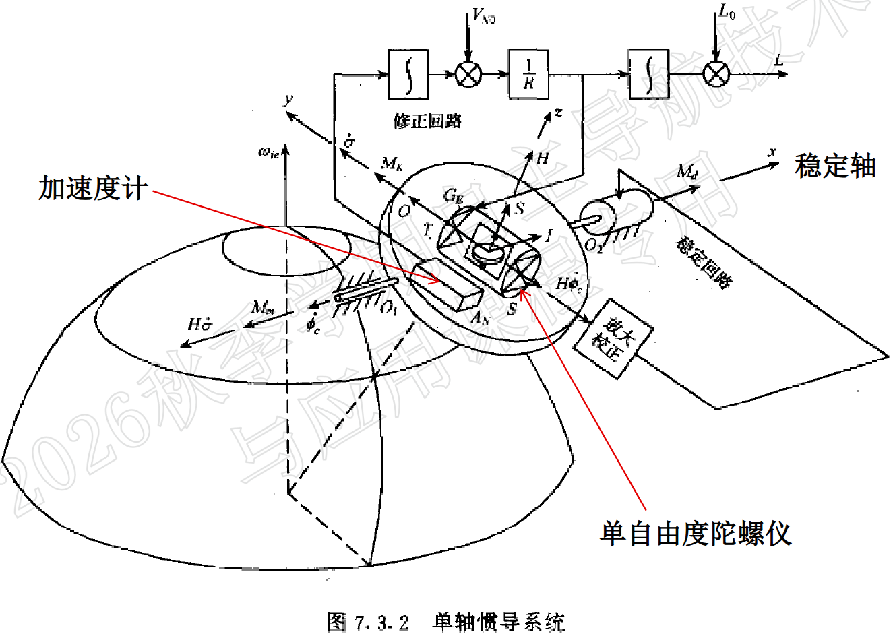

# 惯性器件

陀螺仪，满足动量矩定理 $M=J\dot{\omega}$

加速度计，满足牛顿第二定理 $F=ma$ 

## 轴矢量的方向

**轴矢量：** 方向沿转动轴，正负由右手螺旋定则确定。

轴矢量可以按坐标轴分解，满足平行四边形法则

**力矩：** 右手四指从 $\vec{r}$ 转向 $\vec{F}$  ，拇指所指方向就是 $\vec{M}$ 的方向

**角速度：** 右手四指为转动方向，拇指为矢量方向

## 机械转子陀螺仪

陀螺转子绕自转轴高速旋转，并且其转速近似为常值

**按框架数目**（自转轴的自由度）：单自由度陀螺，双自由度陀螺

**按支承类型**：液浮陀螺仪，气浮陀螺仪，磁悬浮陀螺仪

## 角动量定理（了解即可）

$$\vec{M}=\frac{d\vec{H}}{dt}$$

**进动性：** $\vec{M}\neq0$，右手四指从自转角动量 $\vec{H}$  转向外力矩 $\vec{M}$ ，拇指所指方向就是进动角速度 $\vec{\omega}_p$ 的方向。$\vec{H}$的增量方向等于$\vec{M}$的方向

注：自转角动量方向依照右手定则确定

**定轴性：** $\vec{M}= 0$，自转角动量大小和方向都不变，自转轴方向在惯性空间中固定

## 光学陀螺仪（测光程差）

**萨格奈克效应（会用即可）**：描述了一个闭合光路在旋转时，其中相向传播的两束光会产生相位差，与闭合光路转动**角速度**成正比，且与**光路形状**无关

$$
\Delta L=\frac{4S}{c}\Omega
$$

其中，$\Delta L$ 为光程差，$S$为光路围成的面积，$\Omega$为角速度，$c$为光速

光程差发生改变时，可以通过光学干涉仪观察到干涉条纹图样， 当整个系统旋转时， 条纹图样发生横向移动，由此可以计算旋转角速度

**相干性：** 两列波的相位关系高度稳定、步调一致，激光相干性极好

**干涉：** 光通过狭缝（宽度小于等于光波长）时，发生衍射现象，不满足直线传播，子光源由于光程差会发生干涉现象

## 激光陀螺仪（测频率差）

**增益介质：** 自发辐射、受激辐射，筛选满足谐振腔长度等于波长的整数倍的光（光谐振建立速度极快，谐振光即为测频率差的对应波长的光）

**频率差为：**
$$
\Delta f=\frac{4S}{L\lambda}\Omega=K\Omega
$$

$L$为谐振腔长度，$\lambda$激光的真空波长（通常由正反频率取平均得到），$S$为谐振腔围成的面积，$K=\frac{4S}{L\lambda}$为标度因数

**闭锁效应：** 
环形激光陀螺中，由于反射镜等元件的背向散射，顺时针和逆时针两束光会相互注入。当转速很低、两束光的频率差小于锁定带宽时，它们会被拉到同一频率，拍频消失，陀螺输出为零

**锁定带宽：** 能让两束光（或振荡器与注入信号）被拉到同一频率的最大频率差

**抖动偏频：** 给陀螺施加一个已知的高频抖动角速度，使瞬时角速度周期性地 远大于锁区，让陀螺大部分时间处于解锁状态；然后通过解调，把抖动分量扣除，得到真实角速度

## 光纤陀螺仪（测相位差）

**公式推导**

$$ \Delta L = \frac{N \times 4\pi R^2}{c} \Omega = \frac{2RL}{c} \Omega $$

$$ \Delta L = \frac{\lambda \cdot \Delta \varphi}{2\pi} $$

$$ \Delta \varphi = \frac{4\pi RL}{\lambda c} \Omega $$

$N$为圈数，$L$ 为光纤长度，$R$ 为光纤环半径， $c$ 为光速
## 其他陀螺仪

#### 微机械陀螺仪

#### 微光电陀螺仪

#### 原子陀螺仪

## 加速度计

$$f=\frac{F_弹}{m}=a+g$$

$a$为运动加速度，g为自由引力加速度（规定均以上为正向）

$f$为比力，测量的是弹簧力对应的加速度，不是运动加速度

# 地球描述

## 地垂线与维度

- 地理垂线：	参考椭球面的法线	
- 天文垂线：	大地水准面的法线，即重力方向/铅垂线		
- 地心垂线：	地面点与地心的连线，即地心向径	

维度：对应垂线与赤道平面夹角

## 休拉调谐

$$
  T_s = 2\pi\sqrt{\frac{R}{g}} \approx 84.4 \text{ 分钟}
$$

*  **平台的物理结构层（由外向内）**：基座与环架层、平台台体层（固定惯性器件）、陀螺仪层（内含转子）

*   **休拉调谐原理**：将系统自然频率调至 $\sqrt{g/R}$（周期约84.4分钟），等效于摆长为地球半径的理想摆，使系统对沿地表运动的载体加速度产生“免疫”（无稳态偏差）。
*   **双环协同实现**：**修正回路**（积分加速度算角速度，跟踪地球曲率）通过进动控制实现缓慢修正，**稳定回路**（隔离高频振动干扰）通过伺服力矩控制实现抗干扰，两者快慢分离，互不矛盾。
*   **转子的核心价值**：陀螺仪转子并非“死守”绝对惯性，而是作为极其坚固的抗扰基准，通过力矩器接收指令产生“受控进动”。它既隔离了外界干扰，又让平台精确跟随当地水平面。

# 惯导基本方程(不考)

$$ \left.\frac{\mathrm{d}R}{\mathrm{d}t}\right|_i = \left.\frac{\mathrm{d}R}{\mathrm{d}t}\right|_e + \omega_{ie} \times R $$

$$
\left.\frac{\mathrm{d}^2 R}{\mathrm{d}t^2}\right|_i
= \left.\frac{\mathrm{d} V_{ep}}{\mathrm{d}t}\right|_i
+ \frac{\mathrm{d}}{\mathrm{d}t}\bigl(\omega_{ie}\times R\bigr)\Big|_i
$$

其中 $\omega_{ie}$为常数，$\displaystyle\left.\frac{\mathrm{d}\omega_{ie}}{\mathrm{d}t}\right|_i=0$，于是

$$
\left.\frac{\mathrm{d}^2 R}{\mathrm{d}t^2}\right|_i
= \left.\frac{\mathrm{d}V_{ep}}{\mathrm{d}t}\right|_i
+ \omega_{ie}\times\left.\frac{\mathrm{d}R}{\mathrm{d}t}\right|_i
$$

而 $V_{ep}$ 通常在导航（平台/载体）坐标系 $p$ 内分解：

$$
\left.\frac{\mathrm{d}V_{ep}}{\mathrm{d}t}\right|_i
= \left.\frac{\mathrm{d}V_{ep}}{\mathrm{d}t}\right|_p + \omega_{ip}\times V_{ep}
$$

$$
\left.\frac{\mathrm{d}^2 R}{\mathrm{d}t^2}\right|_i
= \left.\frac{\mathrm{d}V_{ep}}{\mathrm{d}t}\right|_p
+ \omega_{ip}\times V_{ep}
+ \omega_{ie}\times\bigl(V_{ep}+\omega_{ie}\times R\bigr)
$$

由角速度合成定理 $\omega_{ip}=\omega_{ie}+\omega_{ep}$

$$
\boxed{
\left.\frac{\mathrm{d}^2 R}{\mathrm{d}t^2}\right|_i
= \left.\frac{\mathrm{d}V_{ep}}{\mathrm{d}t}\right|_p
+ (2\omega_{ie}+\omega_{ep})\times V_{ep}
+ \omega_{ie}\times(\omega_{ie}\times R)
}
$$

$$
\left.\frac{\mathrm{d}^2 R}{\mathrm{d}t^2}\right|_i = f + G（考虑引力影响，三者均正向为上）
$$

$$
f + G = \dot{V}_{ep} + (2\omega_{ie} + \omega_{ep}) \times V_{ep} + \omega_{ie} \times (\omega_{ie} \times R)
$$

$$
\boldsymbol{g}=\boldsymbol{G}-\boldsymbol{\omega}_{ie}\times(\boldsymbol{\omega}_{ie}\times \boldsymbol{R})
$$

$$
\dot{V}_{ep} = f - (2\omega_{ie} + \omega_{ep}) \times V_{ep} + g
$$

$$
\begin{bmatrix}
\dot{V}_x^p \\
\dot{V}_y^p \\
\dot{V}_z^p
\end{bmatrix}
=
\begin{bmatrix}
f_x^p \\
f_y^p \\
f_z^p
\end{bmatrix}
-
\begin{bmatrix}
0 & -(2\omega_{iez}^p + \omega_{epz}^p) & 2\omega_{iey}^p + \omega_{epy}^p \\
2\omega_{iez}^p + \omega_{epz}^p & 0 & -(2\omega_{iex}^p + \omega_{epx}^p) \\
-(2\omega_{iey}^p + \omega_{epy}^p) & 2\omega_{iex}^p + \omega_{epx}^p & 0
\end{bmatrix}
\begin{bmatrix}
V_x^p \\
V_y^p \\
V_z^p
\end{bmatrix}
+
\begin{bmatrix}
0 \\
0 \\
-g
\end{bmatrix}
$$

## 比力方程的物理意义

$$ \dot{V}_{ep} = f - (2\omega_{ie} + \omega_{ep}) \times V_{ep} + g $$

*   **$\dot{V}_{ep}$**：载体对地球的速度在平台系各分量的变换率。
*   **$f$**：**比力，加速度计的测量值**。
*   **$(2\omega_{ie} + \omega_{ep}) \times V_{ep}$**：包含两部分含义：
    *   $2\omega_{ie}$：地球自转角速度在平台系中的表示。
    *   $\omega_{ep}$：平台系相对地球系的角速度在平台系中的表示。
    *   $g$：正向为天，实际值为$(0,0,-g)^T$

**注：** 

- 只有当加速度计的输出去掉了有害加速度之后，才能积分得到地速。
- 比力方程本质：单纯用比力去掉$g$视作加速度不对，这处理了“当前比力怎么表示”，还没有处理“之前积累的速度怎么转换到当前坐标系。

