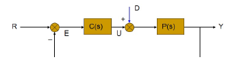

## 学情分析

矩阵分析抽象性高，投入大，需认真学习

## 引言

### 矩阵理论的应用

使用矩阵为 MIMO 系统的描述带来方便：

- 单入单出系统 → 多入单出系统 → 多入多出系统.

$$
\frac{E(s)}{R(s)}=\frac{1}{1+C(s)P(s)} \tag{1.1}
$$

$$
E(s)=\begin{bmatrix}\frac{1}{1+C(s)P(s)} & \frac{-P(s)}{1+C(s)P(s)}\end{bmatrix}\begin{bmatrix}R(s)\\ D(s)\end{bmatrix} \tag{1.2}
$$

$$
\begin{bmatrix}E(s)\\ U(s)\end{bmatrix}=\begin{bmatrix}\frac{1}{1+C(s)P(s)} & \frac{-P(s)}{1+C(s)P(s)}\\ \frac{C(s)}{1+C(s)P(s)} & \frac{-C(s)P(s)}{1+C(s)P(s)}\end{bmatrix}\begin{bmatrix}R(s)\\ D(s)\end{bmatrix} \tag{1.3}
$$

### 矩阵在控制系统设计中的应用

- 能控能观性： $\text{rank}([B\ AB\ \cdots\ A^{n-1}B])=n$
- 控制对象的镇定问题
- 状态观测器的稳定性问题
- 控制器的极点配置问题
- 系统的稳定性与鲁棒性
- 数字控制器的实现——哪种结构更好
- 估计与滤波