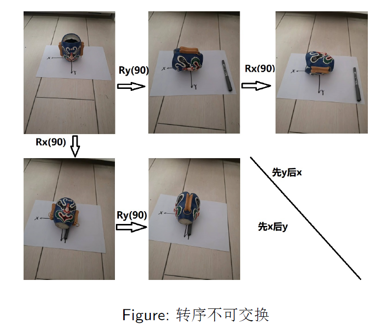

# 线性空间

## 线性空间的定义 

设 $V$ 是非空集合，$F$ 是数域。

$V$ 上定义加法：

$$
+:V\times V\rightarrow V;\ (\alpha,\beta)\mapsto\alpha+\beta 满足唯一、封闭性
$$ 

$V$上定义数乘：

$$
\cdot:V\times F\rightarrow V;\ (\alpha,k)\mapsto\alpha\cdot k  满足唯一、封闭性
$$

同时，这两种运算满足：

1. **加法交换律：** $\alpha+\beta=\beta+\alpha,\ \forall\alpha,\beta\in V$
2. **加法结合律：** $(\alpha+\beta)+\gamma=\alpha+(\beta+\gamma),\ \forall\alpha,\beta,\gamma\in V$
3. **零元素：** $\exists\underline{0}\in V$，对 $\forall\alpha\in V$，都有 $\alpha+\underline{0}=\alpha$
4. **负元素：** $\forall\alpha\in V,\ \exists\beta\in V$，使 $\alpha+\beta=\underline{0}\in V$
5. $1\in F,\ \forall\alpha\in V,\ \alpha\cdot 1=\alpha$
6. $(\alpha\cdot k)\cdot l=\alpha\cdot(kl)$
7. $\alpha\cdot(k+l)=\alpha\cdot k+\alpha\cdot l,\ \forall\alpha\in V,\ \forall k,l\in F$
8. $(\alpha+\beta)\cdot k=\alpha\cdot k+\beta\cdot k$

称 $V$ 为定义在数域 $F$ 上的关于此加法和数乘的一个线性空间，记为 $V(F)$

**注：** 基域$F$提供系数$k$，空间$V$提供基向量

## 性质解释

1. **数域 $F$ (field)：** 对加、减、乘、除（$0$ 不做除数）四则运算封闭；$\mathbb{R}$ 实数域，$\mathbb{C}$ 复数域；$\mathbb{Q}$ 有理数域；有理分式域；整数环 (ring)；多项式环。
2. 对 "$+,\cdot$" 运算结果唯一、封闭性是必须的，且独立于其它条件（不依赖排序、选取等等）
3. 暗含零元素唯一，记为 $\underline{0}=\alpha\cdot 0$。

   设 $e_1,e_2$ 都是零元素，则 $e_1=e_1+e_2=e_2$；$\alpha\cdot 0+\alpha\cdot 0=\alpha\cdot 0\Rightarrow\alpha\cdot 0=\underline{0}$。

4. 暗含 $\forall\alpha\in V$ 负元素唯一，记为 $\beta=\alpha\cdot(-1)=-\alpha$。

   设 $\beta_1,\beta_2$ 都是 $\alpha$ 的负元素，则 $\beta_1=\beta_1+\underline{0}=\beta_1+\alpha+\beta_2=\beta_2$。

5. 暗含移项规则：
   $$
   \alpha+\beta=\gamma\Rightarrow\alpha=\gamma-\beta
   $$
6. 数乘把数写在右侧可以带来方便
7. 为方便起见 "$\cdot$" 可以省略
8.  为方便起见，$V$ 中元素也可被称为向量，但应理解为广义的向量
9.  谈线性空间，一定要明确是按哪两种运算组成的（广义  $"+"\quad "\cdot"$ ）

## 符号说明

**运算：**

$$
\begin{align*}
f():V_1\times V_2&\rightarrow W;\\
(a,b)&\mapsto c\\
c&=f(a,b);\ a\in V_1,\ b\in V_2,\ c\in W;
\end{align*}
$$

**笛卡儿积：** "$×$"

$$
\begin{align*}
V&=V_1\times V_2\\
V&=\{(a,b)\mid a\in V_1,\ b\in V_2\}\\
(a,b)&\in V_1\times V_2\\
& 也可表示为列向量 \begin{bmatrix}a\\ b\end{bmatrix}
\end{align*}  
$$

注：有序$(a,b)\neq(b,a)$，$V_1,V_2$配对所有可能

$F^n=F\times F\times\cdots\times F$代表n维有序数对

## 常用的线性空间

- **例 1.1.1** $n$维实向量集合 $\mathbb{R}^n$，$m\times n$维实矩阵集合 $\mathbb{R}^{m\times n}$，按矩阵加法和矩阵数乘，都构成实数域 $\mathbb{R}$ 上的线性空间
- **例 1.1.2** $n$维复向量集合 $\mathbb{C}^n$，$m\times n$维复矩阵集合 $\mathbb{C}^{m\times n}$ 都构成复数域 $\mathbb{C}$ 上的线性空间
- **例 1.1.3** 全体实函数集合构成实数域 $\mathbb{R}$ 上的线性空间。
- **例 1.1.4** 实数域 $\mathbb{R}$ 上全体次数小于 $n$ 的多项式与零多项式的集合 $\mathbb{R}[x]_n$ 构成实数域 $\mathbb{R}$ 上的线性空间（把"小于 $n$"改为"等于 $n$"，可能n阶相消降阶）
- **例 1.1.5** $A\in\mathbb{R}^{m\times n}$，$x\in\mathbb{R}^n$，$Ax=\underline{0}$ 的解集，是线性空间。称为**核空间**（或核，null space）。记为 $N(A)$，或 $\text{Null}(A)$，或 $\text{Ker}(A)$。
- **例 1.1.6** $A\in\mathbb{R}^{m\times n}$，$x\in\mathbb{R}^n$，$Ax=b\neq 0$ 的解集，**不是**线性空间。
- **例 1.1.7** 给定 $A\in\mathbb{R}^{m\times n}$，其值域：$R(A)=\{Ax\mid x\in\mathbb{R}^n\}$ 是线性空间（$Ax$为列空间）
- **例 1.1.8** 3维矢量空间是数域 $\mathbb{R}$ 上的线性空间

- **例 1.1.9** 广义线性空间：全体正的实数 $\mathbb{R}^+$ 在下面的加法与数乘的定义下也构成数域 $\mathbb{R}$ 上的线性空间：

$$
a\oplus b:=ab,\quad\forall a,b\in\mathbb{R}^+
$$

$$
a\odot k:=a^k,\quad\forall a\in\mathbb{R}^+,\ k\in\mathbb{R}
$$

- **例 1.1.10** 广义向量：$\dfrac{d^2y}{dx^2}+y=0$ 的解集是线性空间

此空间中的一个向量是一个函数，即 $\sin(x)$ 和 $\cos(x)$ 的复系数"组合"

## 矢量相关

 - 三维空间中，任意两个矢量的加法 $\alpha+\beta$：按平行四边形法则确定

 - 矢量与数的数乘运算 $\alpha\cdot k$：矢量 $\alpha$ 伸缩 $k$ 倍。

 - 矢量合成的平行四边形法则向高维的推广。

什么是矢量？

所谓"空间角度"也不是矢量
如果认为一次旋转 $a$ 接着一次旋转 $b$ 是加法 $a+b$，这不满足矢量加法的交换律，因此旋转角度不构成线性空间

## 本课程指导思想

赋予代数概念以几何上的解释

1. 线性空间是 3-维矢量空间的推广。
2. 加法与数乘是平行四边形法则的推广。
3. 线性空间 8 条原则揭示了矢量的代数本质

# 线性组合与基

## 线性组合的定义

设 $V$ 是定义在数域 $F$ 上的线性空间，$\alpha_1,\alpha_2,\ldots,\alpha_m$ 是 $V$ 中的一组向量，$k_1,k_2,\ldots,k_m$ 是 $F$ 中的一组数，若 $V$ 中向量 $\alpha$ 可以表示成：

$$
\alpha=\alpha_1\cdot k_1+\alpha_2\cdot k_2+\cdots+\alpha_m\cdot k_m
$$

则称 $\alpha$ 可由 $\alpha_1,\alpha_2,\ldots,\alpha_m$ **线性表出** (Linear Representation)，或称 $\alpha$ 是 $\alpha_1,\alpha_2,\ldots,\alpha_m$ 的**线性组合**。

**注：**
1. 不要求表出形式唯一；
2. $\alpha_i$ 可以有 $0$；
3. $k_i$ 可以有 $0$，也可以全为 $0$，不做要求。

**从线性表示的角度解读 $C=AB$：**

$$
[c_1\ c_2\ \cdots\ c_p]=A_{m\times n}\begin{bmatrix}b_{11}&b_{12}&\cdots&b_{1p}\\ b_{21}&b_{22}&\cdots&b_{2p}\\ \vdots&\vdots&&\vdots\\ b_{n1}&b_{n2}&\cdots&b_{np}\end{bmatrix}
$$

## 线性相关的定义

- 设 $V$ 是定义在数域 $F$ 上的线性空间，$\alpha_1,\alpha_2,\ldots,\alpha_r$ 是 $V$ 中的一组向量，若存在 $r$ 个**不全为零**的数，使

$$
\alpha_1\cdot k_1+\alpha_2\cdot k_2+\cdots+\alpha_r\cdot k_r=\underline{0}
$$

则称 $\alpha_1,\alpha_2,\ldots,\alpha_r$ **线性相关** (linear dependence)。

- 若 $\alpha_1\cdot k_1+\alpha_2\cdot k_2+\cdots+\alpha_r\cdot k_r=\underline{0}\Leftrightarrow k_i=0,\ i=1,2,\ldots,r
$

则称 $\alpha_1,\alpha_2,\ldots,\alpha_r$ **线性无关** (linear independence)。

- $\alpha_1,\alpha_2,\ldots,\alpha_r$ 是 $V$ 中的一个向量组，记为向量组 (I)；$\alpha_{i_1},\alpha_{i_2},\ldots,\alpha_{i_s}$ 是其一个线性无关的子组，记为向量组 (II)，若 $\alpha_i,\ i=1,2,\ldots,r$ 均可由向量组 (II) 线性表出，则称向量组 (II) 是向量组 (I) 的一个**极大线性无关组**

- 向量组的一个极大线性无关组中所含向量的个数，称为该向量组的**秩** 

## 基本性质

1. 含有零向量的向量组一定线性相关；
2. 整体无关 $\Rightarrow$ 部分无关；部分相关 $\Rightarrow$ 整体相关；
3. 如果含有向量多的向量组可以由含有向量少的向量组线性表出，那么含有向量多的向量组一定线性相关；
4. 向量组的秩是唯一的，但是其极大线性无关组并不唯一；
5. 如果向量组 (I) 可以由向量组 (II) 线性表出，那么向量组 (I) 的秩 $\leq$ 向量组 (II) 的秩；
6. 等价的向量组（可以相互线性表示的向量组）秩相同

## 基的定义

设 $V$ 为数域 $F$ 上的一个线性空间。如果在 $V$ 中存在 $n$ 个线性无关的向量 $\alpha_1,\alpha_2,\ldots,\alpha_n$，使得 $V$ 中的任意一个向量 $\alpha$ 都可以由 $\alpha_1,\alpha_2,\ldots,\alpha_n$ 线性表出：

$$
\alpha=\alpha_1k_1+\alpha_2k_2+\cdots+\alpha_nk_n=[\alpha_1,\alpha_2,\cdots,\alpha_n]\begin{bmatrix}k_1\\ k_2\\ \vdots\\ k_n\end{bmatrix}
$$

则称 $\alpha_1,\alpha_2,\ldots,\alpha_n$ 为 $V$ 的一个**基底**（基）；$[k_1,k_2,\ldots,k_n]^T$ 为向量 $\alpha$ 在基下的**坐标**。此时我们称 $V$ 为一个 $n$-维线性空间，记为 $V_n(F)$，其维数记为 $\dim V=n$。为方便起见，我们把由基拼成的广义矩阵 $[\alpha_1,\alpha_2,\ldots,\alpha_n]$ 称为**基矩阵**

**基的意义：** 把任意有限 ($n$) 维线性空间都映射为 $F^n$（坐标），且过程可逆

**注：**
1. 在一个确定的基下，坐标唯一
2. $\alpha_i$ 的排列顺序不同，是不同的基
3. 基不唯一
4. 不同的基中所含向量个数相同
5. $\alpha_i$ 是一个广义的向量
6. $\{0\}$ 空间的维数为 $0$

**例 1.2.1** 实数域 $\mathbb{R}$ 上的线性空间 $\mathbb{R}^{2\times 2}$ 中的向量组：

$$
\begin{bmatrix}0&1\\ 1&1\end{bmatrix},\ \begin{bmatrix}1&0\\ 1&1\end{bmatrix},\ \begin{bmatrix}1&1\\ 0&1\end{bmatrix},\ \begin{bmatrix}1&1\\ 1&0\end{bmatrix}
$$

和

$$
\begin{bmatrix}1&0\\ 0&0\end{bmatrix},\ \begin{bmatrix}1&1\\ 0&0\end{bmatrix},\ \begin{bmatrix}1&1\\ 1&0\end{bmatrix},\ \begin{bmatrix}1&1\\ 1&1\end{bmatrix}
$$

都是 $\mathbb{R}^{2\times 2}$ 的基，$\mathbb{R}^{2\times 2}$ 是 4-维线性空间。

**例 1.2.2** 实数域 $\mathbb{R}$ 上的线性空间 $\mathbb{R}[x]_n$ 中的向量组：

$$
1,x,x^2,x^3,\ldots,x^{n-1}
$$

与向量组：

$$
1,x-2,(x-2)^2,(x-2)^3,\ldots,(x-2)^{n-1}
$$

都是 $\mathbb{R}[x]_n$ 的基。$\mathbb{R}[x]_n$ 的维数为 $n$。

## 自然基的定义

为方便起见，我们称 $n$-维数域空间 $\mathbb{R}^n$ 或 $\mathbb{C}^n$ 中的一个基：

$$
\left\{\begin{bmatrix}1\\ 0\\ 0\\ \vdots\\ 0\\ 0\end{bmatrix},\ \begin{bmatrix}0\\ 1\\ 0\\ \vdots\\ 0\\ 0\end{bmatrix},\ \begin{bmatrix}0\\ 0\\ 1\\ \vdots\\ 0\\ 0\end{bmatrix},\ \cdots,\ \begin{bmatrix}0\\ \vdots\\ 0\\ \vdots\\ 0\\ 1\end{bmatrix}\right\}
$$

为**自然基**（或标准基）

## 无限维线性空间

利用维数的定义，线性空间可以分为有限维线性空间和无限维线性空间。具有可数基的无限维线性空间，例：周期为 $2\pi/\omega$ 的周期函数空间（傅里叶级数）：

$$
f(t)=\frac{a_0}{2}+a_1\cos(\omega t)+b_1\sin(\omega t)+a_2\cos(2\omega t)+b_2\sin(2\omega t)+\cdots
$$

$$
=\frac{a_0}{2}+\sum_{n=1}^{\infty}\left[a_n\cos(n\omega t)+b_n\sin(n\omega t)\right]
$$

> 傅里叶级数可以理解为以三角函数为基的组合。

**本门课程主要讨论有限维的线性空间。**

## 过渡矩阵的定义

设 $\alpha_1,\alpha_2,\cdots,\alpha_n$（旧基）和 $\beta_1,\beta_2,\cdots,\beta_n$（新基）是线性空间 $V_n(F)$ 的两个基，它们之间的关系为：

$$
[\beta_1,\beta_2,\cdots,\beta_n]=[\alpha_1,\alpha_2\cdots,\alpha_n]P
$$

$$
P=\begin{bmatrix}a_{11}&a_{12}&\cdots&a_{1n}\\ a_{21}&a_{22}&\cdots&a_{2n}\\ \cdots&\cdots&\cdots&\cdots\\ a_{n1}&a_{n2}&\cdots&a_{nn}\end{bmatrix}
$$

称 $n$阶方阵 $P$ 为从 $\alpha_1,\alpha_2,\cdots,\alpha_n$（旧基）到 $\beta_1,\beta_2,\cdots,\beta_n$（新基）的**过渡矩阵**（基变换）

## 过渡矩阵的性质

**定理 1.2.1** 过渡矩阵 $P$ 可逆

**定理 1.2.2（过渡矩阵与坐标变换）**

任取 $\alpha\in V$，它在 $V$ 的旧基 $\alpha_1,\alpha_2,\cdots,\alpha_n$ 和新基 $\beta_1,\beta_2,\cdots,\beta_n$ 下的坐标分别为 $[x_1,x_2,\cdots,x_n]^T$ 和 $[y_1,y_2,\cdots,y_n]^T$，那么：

$$
\begin{bmatrix}y_1\\ y_2\\ \vdots\\ y_n\end{bmatrix}=P^{-1}\begin{bmatrix}x_1\\ x_2\\ \vdots\\ x_n\end{bmatrix}
$$

**例 1.2.1** 求过渡矩阵，在 $\mathbb{R}^4$ 中，旧基：

$$
\alpha_1=\begin{pmatrix}1\\ 2\\ -1\\ 0\end{pmatrix},\ \alpha_2=\begin{pmatrix}1\\ -1\\ 1\\ 1\end{pmatrix},\ \alpha_3=\begin{pmatrix}-1\\ 2\\ 1\\ 1\end{pmatrix},\ \alpha_4=\begin{pmatrix}-1\\ -1\\ 0\\ 1\end{pmatrix}
$$

新基：

$$
\beta_1=\begin{pmatrix}2\\ 1\\ 0\\ 1\end{pmatrix},\ \beta_2=\begin{pmatrix}0\\ 1\\ 2\\ 2\end{pmatrix},\ \beta_3=\begin{pmatrix}-2\\ 1\\ 1\\ 2\end{pmatrix},\ \beta_4=\begin{pmatrix}1\\ 3\\ 1\\ 2\end{pmatrix}
$$

求从旧基到新基的过渡矩阵（求标准型线性表示）

**例 1.2.2** 双线性变换的坐标变换，设：

$$
G(s)=\frac{a_0+a_1s+\cdots+a_ns^n}{b_0+b_1s+\cdots+b_ns^n}
$$

求：

$$
\tilde{G}(z^{-1})=G\left(\frac{1-z^{-1}}{T}\right)=\frac{c_0+c_1z^{-1}+\cdots+c_nz^{-n}}{d_0+d_1z^{-1}+\cdots+d_nz^{-n}}
$$

**Z变换满足线性特性：**

$$
[1\ s\ \cdots\ s^n]=[1\ z^{-1}\ \cdots\ z^{-n}]P
$$

$$
P=\begin{bmatrix}1&1&\cdots&1\\ 0&-1&\cdots&C_n^1(-1)\\ \vdots&\vdots&\ddots&\vdots\\ 0&0&\cdots&(-1)^n\end{bmatrix}\begin{bmatrix}1&&&\\ &\frac{1}{T}&&\\ &&\ddots&\\ &&&\frac{1}{T^n}\end{bmatrix}
$$

$$
\begin{bmatrix}c_0\\ \vdots\\ c_n\end{bmatrix}=P\begin{bmatrix}a_0\\ \vdots\\ a_n\end{bmatrix},\quad \begin{bmatrix}d_0\\ \vdots\\ d_n\end{bmatrix}=P\begin{bmatrix}b_0\\ \vdots\\ b_n\end{bmatrix}
$$

# 子空间

## 线性子空间

定义：$W$ 是线性空间 $V(F)$ 中的一个非空子集，若 $\forall\alpha,\beta\in W,\ \forall k\in F$，都有：

1. $\alpha+\beta\in W$
2. $\alpha k\in W$

则称 $W$ 为 $V$ 的一个**线性子空间**

> $\mathbb{R}^2$ 不是 $\mathbb{R}^3$ 的子空间（三维有序对，二维有序对）

**注：**
- $W$ 中的加法、数乘继承自母空间。
- 满足 (2) 暗含 $0$ 一定在 $W$ 中；
- 满足 (1)(2) 暗含 $-\alpha$ 一定在 $W$；
- $W$ 对运算封闭，首先是线性空间。

## 平凡子空间

对于任意一个线性空间 $V$，必有两个平凡的子空间，即由单个零向量构成的子空间 $\{0\}$ 以及线性空间 $V$ 本身。

> 注：与平凡子集不同，是 $\{0\}$，而不是 $\emptyset$。

## 齐次方程组的解空间

设 $A\in\mathbb{R}^{m\times n}$，那么线性方程组 $Ax=0$ 的全部解为 $n$-维线性空间 $\mathbb{R}^n$ 的一个子空间，我们称其为**齐次线性方程组的解空间**。

- 当齐次线性方程组 $Ax=0$ 有无穷多解时，其解空间的基底即为其**基础解系**；
- 解空间的维数即为基础解系所含向量的个数。

## 矩阵子空间

实数域 $\mathbb{R}$ 上的线性空间 $\mathbb{R}^{n\times n}$ 中：全体上三角矩阵集合，全体下三角矩阵集合，全体对称矩阵集合，全体反对称矩阵集合分别都构成 $\mathbb{R}^{n\times n}$ 的子空间。

> 思考：这几个子空间的基底与维数分别是什么？

## 生成子空间

**定义：** 设 $\alpha_1,\alpha_2,\cdots,\alpha_s$ 为 $n$维线性空间 $V$ 中的一组向量，那么非空子集合：

$\operatorname{span}\{\alpha_1,\alpha_2,\cdots,\alpha_s\}=\{\alpha_1k_1+\alpha_2k_2+\cdots+\alpha_sk_s\mid\forall k_i\in F\}
$

构成线性空间 $V$ 的一个子空间，称此子空间为**有限生成子空间**，称 $\alpha_1,\alpha_2,\cdots,\alpha_s$ 为该子空间的**生成元**。

**注：**
- span为生成空间
- $\alpha_1,\alpha_2,\cdots,\alpha_s$ 中可以有 $0$，也可以全为 $0$，不做要求。
- $k_1,k_2,\cdots,k_s$ 也可以全为 $0$，不做要求。
- $\{\alpha_1,\alpha_2,\cdots,\alpha_s\}$ 中的一个极大线性无关组构成 $\operatorname{span}\{\alpha_1,\alpha_2,\cdots,\alpha_s\}$ 的一个基。

#### 定理 1.3.1

$$
\dim\operatorname{span}\{\alpha_1,\alpha_2,\cdots,\alpha_n\}=\operatorname{rank}\{\alpha_1,\alpha_2,\cdots,\alpha_n\}
$$

#### 定理 1.3.2

$$
\operatorname{span}\{\alpha_1,\alpha_2,\cdots,\alpha_n\}=\operatorname{span}\{\beta_1,\beta_2,\cdots,\beta_m\}
$$

$\Leftrightarrow$ $\{\alpha_1,\alpha_2,\cdots,\alpha_n\}$ 与 $\{\beta_1,\beta_2,\cdots,\beta_m\}$ 可以相互线性表出（即等价）

## 交空间与和空间

设 $V_1,V_2$ 是线性空间 $V$ 的子空间，

- 称$V_1\cap V_2=\{\alpha\mid\alpha\in V_1\cap V_2\}
$为 $V_1$ 与 $V_2$ 的**交空间**。

- 称$V_1+V_2=\{\alpha=\alpha_1+\alpha_2\mid\alpha_1\in V_1,\ \alpha_2\in V_2\}$为 $V_1$ 与 $V_2$ 的**和空间**

> 注："和空间"并不一定是 $V_1\cup V_2$

**例 1.3.5** 设 $A\in\mathbb{C}^{m\times n}$，$B\in\mathbb{C}^{p\times n}$，则 $N(A)\cap N(B)$ 为：

$$
\begin{bmatrix}A\\ B\end{bmatrix}x=0
$$
的解空间

#### 定理 1.3.3

设 $V_1=\operatorname{span}\{\alpha_1,\alpha_2,\cdots,\alpha_s\}$，$V_2=\operatorname{span}\{\beta_1,\beta_2,\cdots,\beta_t\}$，则：

$$
V_1+V_2=\operatorname{span}\{\alpha_1,\alpha_2,\cdots,\alpha_s,\beta_1,\beta_2,\cdots,\beta_t\}
$$

#### 定理 1.3.1'（基的扩充定理）

设 $\alpha_1,\alpha_2,\cdots,\alpha_t,\ t<n$ 是 $n$-维线性空间 $V_n$ 中的一个线性无关组，则可找到 $n-t$ 个向量 $\alpha_{t+1},\alpha_{t+2},\cdots,\alpha_n$，使得 $\alpha_1,\alpha_2,\cdots,\alpha_n$ 是 $n$ 维线性空间 $V_n$ 的一个基。

#### 定理 1.3.4（维数公式）

设 $V_1,V_2$ 是线性空间 $V$ 的子空间，则：

$$
\dim(V_1+V_2)=\dim V_1+\dim V_2-\dim(V_1\cap V_2)
$$

## 直和

设 $V_1,V_2$ 是线性空间 $V$ 的子空间，若 $V_1\cap V_2=\{0\}$，则称 $V_1$ 与 $V_2$ 的和空间为**直和**，记为 $V_1\oplus V_2$

#### 直和的等价条件

设 $V_1,V_2$ 是线性空间 $V$ 的子空间，则以下等价：

1. $V_1\oplus V_2$（即 $V_1\cap V_2=\{0\}$）。
2. $\dim(V_1+V_2)=\dim V_1+\dim V_2$。
3. 若 $\{\alpha_1,\alpha_2,\cdots,\alpha_s\}$ 是 $V_1$ 的基，$\{\beta_1,\beta_2,\cdots,\beta_t\}$ 是 $V_2$ 的基，则 $\{\alpha_1,\alpha_2,\cdots,\alpha_s,\beta_1,\beta_2,\cdots,\beta_t\}$ 是 $V_1+V_2$ 的基。
4. 对 $\forall\alpha\in V_1+V_2$，存在唯一的 $\beta\in V_1$ 和 $\gamma\in V_2$，使得 $\alpha=\beta+\gamma$

## 直和分解

设 $W,W_1,W_2$ 是线性空间 $V$ 的子空间，若：

$$
W=W_1\oplus W_2
$$

则称 $W$ 可分解为**直和**。

## 补子空间

设 $V=W=W_1\oplus W_2$，则称 $W_1$ 与 $W_2$ 为线性空间 $V$ 的一对**补子空间**，并称 $W_2$ 为 $W_1$ 的**补**（或称 $W_1$ 为 $W_2$ 的补）。

#### 定理 1.3.6

设 $U$ 是线性空间 $V$ 的子空间，则必存在 $U$ 的补子空间 $W$，使得：

$$
V=W\oplus U
$$

> 注：补子空间不唯一。例如 $\mathbb{R}^2$ 中一条直线的补不唯一。

# 线性映射

## 线性映射的定义

设 $V_{1}, V_{2}$ 是数域 $F$ 上的两个线性空间。映射 $\mathscr{A}: V_{1} \rightarrow V_{2}$，如果对于任何两个向量 $\alpha_{1}, \alpha_{2} \in V_{1}$ 和任何数 $\lambda \in F$，都有

$$
\mathscr{A}(\alpha_{1} + \alpha_{2}) = \mathscr{A}(\alpha_{1}) + \mathscr{A}(\alpha_{2})
$$

$$
\mathscr{A}(\alpha_{1}\lambda) = \mathscr{A}(\alpha_{1})\lambda
$$

则称映射 $\mathscr{A}$ 是由 $V_{1}$（定义域）到 $V_{2}$（像集）的**线性映射**（不要求满射）。称 $\alpha_{1}$ 为 $\mathscr{A}(\alpha_{1})$ 的**原像**，$\mathscr{A}(\alpha_{1})$ 为 $\alpha_{1}$ 的**像**

若 $V_{1} = V_{2}$，则该映射也被称为是一个**线性变换**

> 所谓"线性"，是相对于"线性空间上的运算"的线性（运算与映射对应才有线性），例 $a\oplus b=ab, a\odot k=a^k$，则$\log$为相对应的线性映射

## 线性映射的性质

(1) $\mathscr{A}(\underline{0}) = \underline{0} \in V_{2}$   （此零非彼零）

(2)
$$
\mathscr{A}\left([\alpha_{1}, \alpha_{2}, \cdots, \alpha_{s}]
\begin{bmatrix}
k_{1} \\ k_{2} \\ \vdots \\ k_{s}
\end{bmatrix}\right)
= \mathscr{A}([\alpha_{1}, \alpha_{2}, \cdots, \alpha_{s}])
\begin{bmatrix}
k_{1} \\ k_{2} \\ \vdots \\ k_{s}
\end{bmatrix}
$$

其中，$\mathscr{A}([\alpha_{1}, \alpha_{2}, \cdots, \alpha_{s}]) = [\mathscr{A}(\alpha_{1}), \mathscr{A}(\alpha_{2}), \cdots, \mathscr{A}(\alpha_{s})]$

(3) $\{\alpha_{1}, \alpha_{2}, \cdots, \alpha_{s}\}$ 线性相关 $\Rightarrow$ $\{\mathscr{A}(\alpha_{1}), \mathscr{A}(\alpha_{2}), \cdots, \mathscr{A}(\alpha_{s})\}$ 线性相关，**线性映射一定是不升秩的映射。**

(4) 线性映射的逆映射（如果存在的话）一定是线性映射。

(5) 线性映射的复合一定是线性映射。

$$
\mathscr{A}: V_{1} \rightarrow V_{2}; \quad \mathscr{A}(\alpha_{1}k_{1} + \alpha_{2}k_{2}) = \mathscr{A}(\alpha_{1})k_{1} + \mathscr{A}(\alpha_{2})k_{2}
$$

$$
\mathscr{B}: V_{2} \rightarrow V_{3}; \quad \mathscr{B}(\beta_{1}k_{1} + \beta_{2}k_{2}) = \mathscr{B}(\beta_{1})k_{1} + \mathscr{B}(\beta_{2})k_{2}
$$

$$
\mathscr{B}\mathscr{A}: V_{1} \rightarrow V_{3}; \quad (\mathscr{B}\mathscr{A})(\alpha_{1}k_{1} + \alpha_{2}k_{2}) = (\mathscr{B}\mathscr{A})(\alpha_{1})k_{1} + (\mathscr{B}\mathscr{A})(\alpha_{2})k_{2}
$$

其中，$(\mathscr{B}\mathscr{A})(\alpha) \triangleq \mathscr{B}(\mathscr{A}(\alpha))$。

## 线性映射举例

#### 例 1.4.1 线性映射

任意 $n$ 维线性空间 $V_{n}(F)$，选定一组基 $\{\alpha_{1}, \alpha_{2}, \cdots, \alpha_{n}\}$，$\forall \alpha \in V, \exists x \in F^{n}$ 且唯一，使

$$
\alpha = [\alpha_{1}, \alpha_{2}, \cdots, \alpha_{n}]x
$$

选基，实际上建立了一个映射 $\mathscr{B}: V_{n}(F) \rightarrow F^{n}; \alpha \mapsto x$。同时，也建立了逆映射 $\mathscr{B}^{-1}: F^{n} \rightarrow V_{n}(F); x \mapsto \alpha$。

这两个映射都是线性映射（且一一对应）

#### 例 1.4.2 恒等映射（恒等变换）

$$
\mathscr{I}: V \rightarrow V; \quad \alpha \mapsto \alpha
$$

$$
\mathscr{I}(\alpha) = \alpha, \quad \forall \alpha \in V
$$

是一个线性映射。

#### 例 1.4.3 零映射

$$
\mathscr{O}: V_{1} \rightarrow V_{2}; \quad \alpha \mapsto \underline{0}
$$

$$
\mathscr{O}(\alpha) = \underline{0} \in V_{2}, \quad \forall \alpha \in V_{1}
$$

是一个线性映射。

#### 例 1.4.4 微分映射

$$
\mathscr{D}: \mathbb{R}[x]_{n+1} \rightarrow \mathbb{R}[x]_{n}
$$

$$
\mathscr{D}(f(x)) = \frac{d}{dx}f(x), \quad \forall f(x) \in \mathbb{R}[x]_{n+1}
$$

是一个线性映射。

#### 例 1.4.5 积分映射

$$
\mathscr{S}: \mathbb{R}[x]_{n} \rightarrow \mathbb{R}[x]_{n+1}
$$

$$
\mathscr{S}(f(x)) = \int_{0}^{x} f(t)\,dt, \quad \forall f(x) \in \mathbb{R}[x]_{n}
$$

#### 例 1.4.6 时变线性系统

$$
\dot{X}(t) = A(t)X(t)
$$

$$
X(t_{0}) = X_{0}
$$

其中，$\forall t \in \mathbb{R}, t \geq t_{0}, X(t) \in \mathbb{R}^{n}, A \in \mathbb{R}^{n \times n}$。在任何一个时刻 $t \geq t_{0}$ 可视为映射：

$$
\Psi_{t;t_{0}}: \mathbb{R}^{n} \rightarrow \mathbb{R}^{n}; \quad X_{0} \mapsto X(t)
$$

是一个线性映射（类比状态转移矩阵）。

#### 例 1.4.6 线性映射（证明）

对于 $\forall X_{10}, X_{20} \in \mathbb{R}^{n}$，其像 $X_{1}(t), X_{2}(t)$ 满足

$$
\dot{X}_{j}(t) = A(t)X_{j}(t)
$$

$$
X_{j}(t_{0}) = X_{j0}, \quad j = 1, 2
$$

$\forall k_{1}, k_{2} \in \mathbb{R}, Z_{0} = X_{10}k_{1} + X_{20}k_{2}$，像的组合 $Z(t) = X_{1}(t)k_{1} + X_{2}(t)k_{2}$ 满足

$$
\dot{Z}(t) = A(t)(X_{1}(t)k_{1} + X_{2}(t)k_{2}) = A(t)Z(t)
$$

$$
Z(t_{0}) = X_{10}k_{1} + X_{20}k_{2} = Z_{0}
$$

说明 $Z(t) = X_{1}(t)k_{1} + X_{2}(t)k_{2}$ 是 $Z_{0}$ 的像，故该映射是一个线性映射。

# 矩阵表示

## 线性映射的矩阵表示（有限维）

线性映射 $\mathscr{A}: V_{1} \rightarrow V_{2}$，若 $\{\alpha_{1}, \alpha_{2}, \cdots, \alpha_{n}\}$ 是 $V_{1}$ 的一组基（**入口基**），$\{\beta_{1}, \beta_{2}, \cdots, \beta_{m}\}$ 是 $V_{2}$ 的一组基（**出口基**），

$$
\mathscr{A}([\alpha_{1}, \alpha_{2}, \cdots, \alpha_{n}])
= [\beta_{1}, \beta_{2}, \cdots, \beta_{m}]
\begin{bmatrix}
a_{11} & a_{12} & \cdots & a_{1n} \\
a_{21} & a_{22} & \cdots & a_{2n} \\
\vdots & \vdots & \ddots & \vdots \\
a_{m1} & a_{m2} & \cdots & a_{mn}
\end{bmatrix}
$$

其中，

$$
A =
\begin{bmatrix}
a_{11} & a_{12} & \cdots & a_{1n} \\
a_{21} & a_{22} & \cdots & a_{2n} \\
\vdots & \vdots & \ddots & \vdots \\
a_{m1} & a_{m2} & \cdots & a_{mn}
\end{bmatrix}
$$

被称为线性映射 $\mathscr{A}$ 在入口基和出口基下的**矩阵表示**（representing matrix）。

> $\mathscr{A}([\text{入口基}]) = [\text{出口基}][\text{矩阵表示}]$

## 线性映射的矩阵表示的意义

线性映射 $\mathscr{A}: V_{1} \rightarrow V_{2}$，入口基 $\{\alpha_{1}, \alpha_{2}, \cdots, \alpha_{n}\}$，出口基 $\{\beta_{1}, \beta_{2}, \cdots, \beta_{m}\}$，$\mathscr{A}$ 在这两组基下的矩阵表示为 $A \in F^{m \times n}$，$\forall \alpha \in V_{1}$

$$
\alpha = [\alpha_{1}, \alpha_{2}, \cdots, \alpha_{n}]
\begin{bmatrix}
x_{1} \\ x_{2} \\ \vdots \\ x_{n}
\end{bmatrix},
\qquad
\mathscr{A}(\alpha) = [\beta_{1}, \beta_{2}, \cdots, \beta_{m}]
\begin{bmatrix}
y_{1} \\ y_{2} \\ \vdots \\ y_{m}
\end{bmatrix}
$$

那么，任意线性空间 $V_{1} \rightarrow V_{2}$ 的映射转化为 $F^{n} \rightarrow F^{m}$ 坐标之间的映射

$$
\begin{bmatrix}
y_{1} \\ y_{2} \\ \vdots \\ y_{m}
\end{bmatrix}
= A
\begin{bmatrix}
x_{1} \\ x_{2} \\ \vdots \\ x_{n}
\end{bmatrix}
$$

**矩阵 $A \in F^{m \times n}$ 也对应一个线性映射：**

设 $V_{1}, V_{2}$ 是数域 $F$ 上的两个线性空间。$\{\alpha_{1}, \alpha_{2}, \cdots, \alpha_{n}\}$ 是 $V_{1}$ 的一组基，$\{\beta_{1}, \beta_{2}, \cdots, \beta_{m}\}$ 是 $V_{2}$ 的一组基，

$$
\forall \alpha \in V_{1}, \exists x \in F^{n} \text{ 使 } \alpha = [\alpha_{1}, \alpha_{2}, \cdots, \alpha_{n}]x
$$

对于 $A \in F^{m \times n}$ 定义

$$
\mathscr{A}(\alpha) = [\beta_{1}, \beta_{2}, \cdots, \beta_{m}] A x
$$

可知其是 $V_{1} \rightarrow V_{2}$ 的一个线性映射，线性映射 $\mathscr{A}$ 与其矩阵表示 $A \in F^{m \times n}$ 是**一一对应**的

**注：** 矩阵表示本质是线性映射在出口基下的**对应关系**（等式两边，坐标直接右乘即可）

## 矩阵表示的例子
#### 求例 1.4.4 微分映射的矩阵表示

$$
\mathscr{D}: \mathbb{R}[x]_{4} \rightarrow \mathbb{R}[x]_{3}
$$

$$
\mathscr{D}(f(x)) = \frac{d}{dx}f(x), \quad \forall f(x) \in \mathbb{R}[x]_{4}
$$

求其在入口基 $\{1, x, x^{2}, x^{3}\}$、出口基 $\{1, x, x^{2}\}$ 下的矩阵表示。

$$
\frac{d}{dx}\left(\begin{bmatrix} 1 & x & \cdots & x^{n-1} \end{bmatrix}\right)
=
\begin{bmatrix} 1 & x & x^{2} & \cdots & x^{n-2} \end{bmatrix}
\begin{bmatrix}
0 & 1 & 0 & \cdots & 0 \\
0 & 0 & 2 & \cdots & 0 \\
0 & 0 & 0 & \cdots & 0 \\
\vdots & \vdots & \vdots & \ddots & \vdots \\
0 & 0 & 0 & \cdots & n-1
\end{bmatrix}_{(n-1) \times n}
$$

#### 求例 1.4.5 积分映射的矩阵表示

$$
\mathscr{S}: \mathbb{R}[x]_{3} \rightarrow \mathbb{R}[x]_{4}
$$

$$
\mathscr{S}(f(x)) = \int_{0}^{x} f(t)\,dt, \quad \forall f(x) \in \mathbb{R}[x]_{3}
$$

求其在入口基 $\{1, x, x^{2}\}$、出口基 $\{1, x, x^{2}, x^{3}\}$ 下的矩阵表示

$$
\mathscr{S}\left(\begin{bmatrix} 1 & x & \cdots & x^{n-2} \end{bmatrix}\right)
=
\begin{bmatrix} 1 & x & x^{2} & \cdots & x^{n-1} \end{bmatrix}
\begin{bmatrix}
0 & 0 & 0 & \cdots & 0 \\
1 & 0 & 0 & \cdots & 0 \\
0 & \frac{1}{2} & 0 & \cdots & 0 \\
\vdots & \vdots & \vdots & \ddots & \vdots \\
0 & 0 & 0 & \cdots & \frac{1}{n-1}
\end{bmatrix}_{n \times (n-1)}
$$

#### 求例 1.4.6 时变线性系统状态变换的矩阵表示

$$
\dot{X}(t) = A(t) X(t)
$$

$$
X(t_{0}) = X_{0}
$$

其中，$\forall t \in \mathbb{R}, t \leq t_{0}, X(t) \in \mathbb{R}^{n}, A \in \mathbb{R}^{n \times n}$。在任何一个时刻 $t \geq t_{0}$ 可视为映射：

$$
\Psi_{t;t_{0}}: \mathbb{R}^{n} \rightarrow \mathbb{R}^{n}; \quad X_{0} \mapsto X(t)
$$

记 $n$ 阶单位矩阵 $I_{n}$ 的第 $i$ 列为 $e_{i}$，以此为 $t_{0}$ 时刻初始状态，$t$ 时刻系统状态为 $X_{i}(t)$，求在 $\mathbb{R}^{n}$ 的自然基下该线性映射的矩阵表示。

**推论：** 上述系统任意时刻 $t$ 的状态 $X(t)$ 与初始状态 $X_{0}$ 的关系必可表述为

$$
X(t) = \Psi_{t;t_{0}} X_{0}
$$

其中 $\forall t \geq t_{0}, \Psi_{t;t_{0}} \in \mathbb{R}^{n \times n}$ 与 $X_{0}$ 无关

# 同构

## 同构的定义

若两个定义在 $F$ 上的线性空间 $V_{1}, V_{2}$，存在一个**一一对应**的线性映射 $\sigma: V_{1} \rightarrow V_{2}$，使得对 $\forall \alpha, \beta \in V_{1}, \forall \lambda \in F$ 都有，

(1) $\sigma(\alpha + \beta) = \sigma(\alpha) + \sigma(\beta)$

(2) $\sigma(\alpha\lambda) = \sigma(\alpha)\lambda$

则称 $\sigma$ 为 $V_{1}$ 到 $V_{2}$ 的**同构映射**，称 $V_{1}$ 与 $V_{2}$ 是**同构**的。

## 同构的意义

设 $V_{1}, V_{2}$ 是定义在相同数域 $F$ 上的线性空间，若 $V_{1}$ 与 $V_{2}$ 是同构的，则

(1) $\dim V_{1} = \dim V_{2}$（同构的等价条件）

(2) $V_{1}$ 与 $V_{2}$ 上加法与数乘的结构是一致的（保线性组合）。

(3) $V_{1}$ 与 $V_{2}$ 上对应的向量组的线性相关性是一致的。

(4) **过渡矩阵相同**（**原像之间 和 像之间 的过渡矩阵**）。

(5) 正反一一对应，是对称的。

**同构的思想：**

> 关键： 一一对应，保你感兴趣的结构

> 如 $R^{2\times 2}\to R^{4}$
 

## 定理 1.4.2 线性映射在不同基下的矩阵表示互相等价

若 $V_{1}, V_{2}$ 是定义在数域 $F$ 上的线性空间，$\{\alpha_{1}, \alpha_{2}, \cdots, \alpha_{n}\}$ 和 $\{\alpha'_{1}, \alpha'_{2}, \cdots, \alpha'_{n}\}$ 是 $V_{1}$ 的两个基，$\{\beta_{1}, \beta_{2}, \cdots, \beta_{m}\}$ 和 $\{\beta'_{1}, \beta'_{2}, \cdots, \beta'_{m}\}$ 是 $V_{2}$ 的两个基，由 $\{\alpha_{1}, \alpha_{2}, \cdots, \alpha_{n}\}$ 到 $\{\alpha'_{1}, \alpha'_{2}, \cdots, \alpha'_{n}\}$ 的过渡矩阵为 $P$，由 $\{\beta_{1}, \beta_{2}, \cdots, \beta_{m}\}$ 到 $\{\beta'_{1}, \beta'_{2}, \cdots, \beta'_{m}\}$ 的过渡矩阵为 $Q$，设线性映射 $\mathscr{A}$ 在 $\{\alpha_{i}\}$ 与 $\{\beta_{j}\}$ 下的矩阵表示为 $A$，在 $\{\alpha'_{i}\}$ 与 $\{\beta'_{j}\}$ 下的矩阵表示为 $B$，则

$$
\left\{
\begin{array}{}
\mathscr{A}(\alpha)=\beta A,\mathscr{A}(\alpha')=\beta B\\
\alpha P=Q\beta，\beta Q=\beta'

\end{array}
\right.\\
AP = QB
$$

**矩阵等价：**
设 $A, B \in F^{m \times n}$，若存在可逆矩阵 $Q \in F^{m \times m}, P \in F^{n \times n}$ 满足

$$
A P = Q B
$$

则称 $A$ 与 $B$ **等价**。

**几何意义：** 任意线性映射都可以通过重选入口基和出口基的方式把其矩阵表示化简为

$$
A = Q
\begin{bmatrix}
I & 0 \\
0 & 0
\end{bmatrix}
P^{-1}
$$

# 线性变换与线性变换的运算

## 线性变换的定义

线性映射 $\mathscr{A}: V \rightarrow V$，被称为**线性变换**。

**注：**

(1) 可以不是满射。

(2) 线性变换的入口空间、出口空间相同，因此入口基和出口基也相同。

(3) 线性变换的矩阵表示是方阵。

**例：**

- 前面例子中线性系统的零输入状态转移就是线性变换。
- 微分映射 $\mathscr{D}: \mathbb{R}[x]_{4} \rightarrow \mathbb{R}[x]_{4}$（尽管实际上只映入了一个子空间）

$$
\mathscr{D}(f(x)) = \frac{d}{dx}f(x), \quad \forall f(x) \in \mathbb{R}[x]_{4}
$$

是线性变换。

## 矢量叉乘的矩阵表示形式

$$
\bar{a} = x_{a}i + y_{a}j + z_{a}k
$$

$$
\bar{b} = x_{b}i + y_{b}j + z_{b}k
$$

其叉乘为

$$
\bar{a} \times \bar{b} =
\begin{vmatrix}
i & j & k \\
x_{a} & y_{a} & z_{a} \\
x_{b} & y_{b} & z_{b}
\end{vmatrix}
= (y_{a}z_{b} - z_{a}y_{b})i + (-x_{a}z_{b} + z_{a}x_{b})j + (x_{a}y_{b} - y_{a}x_{b})k
$$

以第二个矢量为变量，可视为是线性变换，在自然基下的矩阵表示

$$
a \times b =
\begin{bmatrix}
0 & -z_{a} & y_{a} \\
z_{a} & 0 & -x_{a} \\
-y_{a} & x_{a} & 0
\end{bmatrix}
\begin{bmatrix}
x_{b} \\ y_{b} \\ z_{b}
\end{bmatrix}
$$

## 定理 1.5.1 换基后线性变换的矩阵表示为相似关系

线性变换 $\mathscr{A}: V \rightarrow V$，在基 $\{\alpha_{1}, \alpha_{2}, \cdots, \alpha_{n}\}$ 下的表示矩阵 $A$，在基 $\{\alpha'_{1}, \alpha'_{2}, \cdots, \alpha'_{n}\}$ 下的表示矩阵为 $B$，由 $\{\alpha_{i}\}$ 到 $\{\alpha'_{i}\}$ 的过渡矩阵为 $P \in \mathbb{R}^{n \times n}, |P| \neq 0$，则

$$
A P = P B
$$

**定义（矩阵相似）：** $n$ 阶矩阵 $A, B$，若存在可逆矩阵 $P$ 使

$$
A P = P B
$$

成立，则称 $A$ 与 $B$ **相似**。

> **相似的几何解释：** 以 $P$ 为过渡矩阵，选一个新基，则线性变换的矩阵表示之间的关系。

## 线性变换的运算

- **乘积** $\mathscr{A}\mathscr{B}$: $(\mathscr{A}\mathscr{B})(\alpha) := \mathscr{A}(\mathscr{B}(\alpha))$
- **加法** $\mathscr{A} + \mathscr{B}$: $(\mathscr{A} + \mathscr{B})(\alpha) := \mathscr{A}(\alpha) + \mathscr{B}(\alpha)$
- **数乘** $\mathscr{A}\lambda$: $(\mathscr{A}\lambda)(\alpha) := \mathscr{A}(\alpha)\lambda$
- **逆变换** $\mathscr{A}^{-1}$：若存在线性变换 $\mathscr{B}$，使 $\mathscr{A}\mathscr{B} = \mathscr{B}\mathscr{A} = \mathscr{I}$（恒等变换），则称 $\mathscr{B}$ 为 $\mathscr{A}$ 的逆变换。

**对应矩阵（作为作业思考，验证与相似关系）：**

- 变换的乘积：$\mathscr{A}\mathscr{B} \Leftrightarrow AB$
- 加法：$\mathscr{A} + \mathscr{B} \Leftrightarrow A + B$
- 数乘：$\mathscr{A}\lambda \Leftrightarrow A\lambda$
- 逆：$\mathscr{A}^{-1} \Leftrightarrow A^{-1}$

# 特征值与特征向量

## 定义 1.6.1 线性变换的特征值与特征向量

设 $\mathscr{A}$ 是线性空间 $V(F)$ 上的线性变换，若存在数域 $(F)$ 中的数 $\lambda_{0}$ 及非零向量 $\xi$，使得

$$
\mathscr{A}(\xi) = \xi \lambda_{0}
$$

则称 $\lambda_{0}$ 为 $\mathscr{A}$ 的**特征值**，$\xi$ 为 $\mathscr{A}$ 的属于特征值 $\lambda_{0}$ 的**特征向量**。

**线性变换与矩阵表示的特征值、特征向量的关系：**

设 $\mathscr{A}$ 是线性空间 $V(F)$ 上的线性变换，在给定基下的矩阵表示为 $A$，则

- $A$ 与 $\mathscr{A}$ 有相同的特征值；
- $A$ 的特征向量与 $\mathscr{A}$ 的特征向量一一对应。

 

## 定义 1.6.2 特征值的几何重数

$n$ 阶矩阵 $A \in F^{n \times n}$ 的特征值 $\lambda_{0}$ 的特征子空间，即 $V$ 中全部特征向量的集合（加上零向量）可以组成$F^n$的一个子空间，称之为 $A$ 的属于特征值 $\lambda_{0}$ 的特征子空间记为 $V_{\lambda_{0}}$，即满足

$$
(\lambda_{0}I - A)X = 0
$$

该子空间的维数称为特征值 $\lambda_{0}$ 的**几何重数**

## 定义 1.6.3 代数重数

设 $A$ 是 $n$ 阶方阵，其特征多项式为

$$
p(\lambda) = \det(\lambda I - A)
$$

设 $A$ 的全部互异特征值为 $\lambda_{1}, \lambda_{2}, \cdots, \lambda_{r}$，其代数重数（即作为特征多项式根的重数）为 $p_{1}, p_{2}, \cdots, p_{r}$，即 $\lambda_{i}$ 是 $p_{i}$ 重特征值，**特征多项式 = 全体 $(\lambda - \lambda_{i})^{p_{i}}$ 的乘积**

## 代数重数与几何重数的关系

n阶方矩阵$A\in F^{n\times n}$的任意一个特征值的几何重数不动于它的代数重数

## 特征向量的性质

(1)一个特征向量不能属于不同的特征值

(2) 属于不同特征值的特征向量线性无关。

设 $\lambda_{1}, \lambda_{2}, \cdots, \lambda_{r}$ 是 $A$ 的全部互异特征值，$\lambda_{i}$ 的特征子空间的维数为 $q_{i}$，$i = 1, 2, \cdots, r$，$\alpha_{i1}, \alpha_{i2}, \cdots, \alpha_{iq_{i}}$ 是属于 $\lambda_{i}$ 的 $q_{i}$ 个线性无关的特征向量，则以下向量组线性无关：

$$
\alpha_{11}, \alpha_{12}, \cdots, \alpha_{1q_{1}};\\
\alpha_{21}, \alpha_{22}, \cdots, \alpha_{2q_{2}};\\
\vdots\\
\alpha_{r1}, \alpha_{r2}, \cdots, \alpha_{rq_{r}}
$$

**推论：** 不同特征值的特征子空间是直和关系（即 $\lambda_{i} \neq \lambda_{j}$ 时）

$$
V_{\lambda_{1}} \oplus V_{\lambda_{2}} \oplus \cdots \oplus V_{\lambda_{r}}
$$

（$V_{1} \oplus V_{2}, V_{1} \oplus V_{3}, V_{2} \oplus V_{3}$ 不能保证 $V_{1} \oplus V_{2} \oplus V_{3}$ ）

# 不变子空间

## 不变子空间的定义

设 $V(F)$ 上的线性变换 $\mathscr{A}$，$W$ 是 $V$ 的子空间，若 $\forall \alpha \in W$ 都有

$$
\mathscr{A}(\alpha) \in W
$$

则称 $W$ 为 $\mathscr{A}$ 的**不变子空间**。

设 $A \in F^{n \times n}$，$W$ 是 $F^{n}$ 的子空间，若 $\forall x \in W$ 都有

$$
A x \in W
$$

则称 $W$ 为 $A$ 的不变子空间。

## 不变子空间举例

- 全空间$V$、零子空间是任何定义在$V$上的线性变换的不变子空间

- $N(A)$ 与 $R(A)$ 是 $A$ 的不变子空间($Ax=0\in N(A)$， $A(Ax)\in R(A)$)
- $A$ 的特征子空间是 $A$ 的不变子空间($Ax=\lambda x\in E_\lambda(A)$)

- 任何子空间都是数乘变换的不变子空间
  
  
- 特征子空间是核与值域中的不变子空间

$\lambda=0$时，特征子空间为核空间，$(A-\lambda I)x=0$

$\lambda\neq 0$时，特征子空间为值域中的不变子空间，$Ax=\lambda x$，$x=\frac{1}{\lambda}Ax\in R(A)$

- 线性变换 $\mathscr{A}$ 的子空间的和、交仍是$\mathscr{A}$的不变子空间

- 设 $W = \operatorname{span}\{\alpha_{1}, \alpha_{2}, \cdots, \alpha_{s}\}$，则

$$
W \text{ 是 } \mathscr{A} \text{ 的不变子空间}
\iff \mathscr{A}(\alpha_{i}) \in W, \quad i = 1, 2, \cdots, s
$$

## 不变子空间化简线性变换的矩阵表示

**化简的目的：** 在适当基下，矩阵呈现分块形式。

设 $W_{1} = \operatorname{span}\{\alpha_{1}, \alpha_{2}, \cdots, \alpha_{s}\}$，$W_{2} = \operatorname{span}\{\beta_{1}, \beta_{2}, \cdots, \beta_{n-s}\}$，且

$$
V = W_{1} \oplus W_{2}
$$

取基

$$
P_{1} = [\alpha_{1}\ \alpha_{2}\ \cdots\ \alpha_{s}], \quad
P_{2} = [\beta_{1}\ \beta_{2}\ \cdots\ \beta_{n-s}]
$$

则有

$$
A\,[P_{1}\ P_{2}] = [P_{1}\ P_{2}]
\begin{bmatrix}
* & 0 \\
0 & *
\end{bmatrix}
$$

（即 $W_{1}, W_{2}$ 均为不变子空间时，在直和基下矩阵分块对角化。）

**线性变换对角化的定义:**
若存在一组基，使 $\mathscr{A}$ 在该组基下的矩阵表示为对角矩阵，则称数域 $F$ 上的 $n$ 维线性空间 $V$ 的线性变换 $\mathscr{A}$ 是可对角化的。$\mathscr{A}$ 在基 $\alpha_{1}, \alpha_{2}, \cdots, \alpha_{n}$ 下的矩阵表示为 $A$

## 对角化的结论

### 定理 1.7.2

线性变换 $\mathscr{A}$ 可对角化 $\iff$ $A$ 可相似对角化。

**单纯矩阵：**$n$ 阶矩阵 $A$ 与对角矩阵相似，则称 $A$ 可对角化，也称A为单纯矩阵。

### 定理 1.7.3

$n$ 阶矩阵 $A$ 可对角化的充要条件：$A$ 有 $n$ 个线性无关的特征向量。

**推论：** 存在可逆矩阵 $P$ 使

$$
A P = P \operatorname{diag}(\lambda_{1}, \lambda_{2}, \cdots, \lambda_{n})
$$

其中 $\lambda_{1}, \lambda_{2}, \cdots, \lambda_{n}$ 是 $A$ 的 $n$ 个特征值，$P$ 的第 $i$ 列是 $A$ 的属于特征值 $\lambda_{i}$ 的特征向量。

### 定理 1.7.4

$n$ 阶矩阵 $A$ 可对角化的充要条件：$A$ 的每个特征值的几何重数等于代数重数。

**推论：** $A$ 的特征多项式无重根 $\Rightarrow$ $A$ 可对角化。

## 线性定常系统的分解

$$
\dot{x} = A x + B u, \quad A \in \mathbb{R}^{n \times n}, \ B \in \mathbb{R}^{n \times m}
$$

$$
\forall t \geq 0, \ x(t) \in \mathbb{R}^{n}, \ u(t) \in \mathbb{R}^{m}
$$

$$
H = [B \ \ AB \ \ \cdots \ \ A^{n-1}B], \quad \operatorname{rank}(H) = r
$$

$R(H)$ 是 $A$ 的不变子空间，则存在可逆矩阵 $P$，令 $z = P^{-1}x$，有

$$
\dot{z} = P^{-1} A P z + P^{-1} B u = \tilde{A} z + \tilde{B} u
$$

$$
\tilde{A} =
\begin{bmatrix}
A_{11} & A_{12} \\
0 & A_{22}
\end{bmatrix},
\quad
\tilde{B} =
\begin{bmatrix}
B_{1} \\ 0
\end{bmatrix},
\quad A_{11} \in \mathbb{R}^{r \times r}, \ B_{1} \in \mathbb{R}^{r \times m}
$$

取 $\operatorname{span}\{H\}$ 的基为 $P_{1}$，扩展为 $\mathbb{R}^{n}$ 的基 $P = [P_{1}\ P_{2}]$ 即得上述分解。

**系统矩阵A分解：** $P_1$的列向量在不变子空间$R(H)$中，故$AP_1$的列向量也在$R(H)$中，

所以$AP_1$完全可以由$R(H)$的基$P_1$线性表示，即存在 $A_{11}$使得$AP_1=P_1A_{11}$

$$AP=[P_1A_{11}  \quad AP_2]=[P_1\quad P_2]
\left[
   \begin{array}{}
   A_{11} & A_{12}\\
   0 & A_{22}
   \end{array}
\right]=P\tilde{A}
$$

**输入矩阵B的分解：** $R(B)\subseteq R(H)$
，分解原理同上
$$B=P_1B_1=[P_1\quad P_2]
\left[
   \begin{array}{}
   B_1\\
   0
   \end{array}
\right]=P\tilde{B}
$$

**关键：** $R(H)$为包含$R(B)$的最小不变子空间（后续学习）
